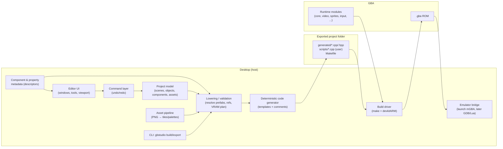
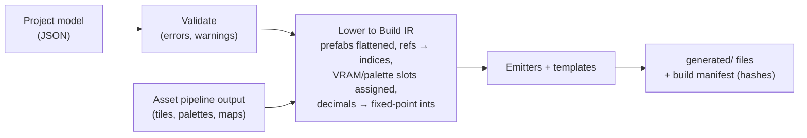

# Architecture

Status: **PROPOSAL (Phase 0)** — nothing here is implemented yet. Items marked
*(proposed)* depend on decisions in `DECISIONS.md` that Omar has not yet approved.

## 1. The big picture

The engine is split into a part that runs **on your PC** (editor, tools) and a part
that runs **on the GBA** (runtime + your game). They only talk through **files**:
the PC side writes C++ source, asset data and a Makefile; devkitARM compiles them
into a ROM. That file boundary is what makes exported projects buildable without
the editor.



## 2. Modules and responsibilities

| # | Module | Runs on | Responsibility | Must NOT |
|---|---|---|---|---|
| 1 | `editor/` | PC | Windows, viewport, tools, input handling | contain build/codegen logic |
| 2 | `core/model` | PC | Project/scene/prefab/asset data, load/save, schema versions & migration | depend on UI |
| 3 | `core/meta` | PC | Component & property descriptors (built-in and custom) | — |
| 4 | `core/assets` | PC | Import PNG, quantize, tile, dedupe, emit binary data + reports | depend on UI |
| 5 | `core/codegen` | PC | Lowered model → source text + comments, deterministically | read clocks, env, absolute paths |
| 6 | `core/build` | PC | Invoke `make`, capture & parse logs, map files for memory use | — |
| 7 | `runtime/` | GBA (and PC for tests) | Boot, IRQ, video, sprites, input, math, scene loader, modules | know about the editor or JSON |
| 8 | Rendering profiles | both | Per-profile editor tools + lowering rules + runtime module | — |
| 9 | `core/emu` | PC | Launch mGBA; later GDB stub / Lua scripting / libmgba | — |
| 10 | `tests/`, `samples/` | both | Unit, golden, ROM and emulator tests; demo projects | — |

The **command layer** sits between the UI and the model: every edit (move object,
add component) is a small `Command` object with `apply()` and `revert()`. That gives
undo/redo for free and lets us test editor behaviour without a window.

The **CLI** uses exactly the same core libraries as the editor. If the CLI can build
a project, the editor can too — and CI can test everything headlessly.

## 3. Editor/runtime boundary

- The editor can be rich and object-oriented (inheritance, strings, dynamic arrays).
- The runtime is small, static and data-oriented. It never parses JSON, never sees
  names it doesn't need, and uses no heap in normal operation.
- Everything "editor-only" (names, hierarchy for organization, prefab inheritance,
  editor gizmos, original PNGs) is **resolved at build time** in the lowering step.
- The runtime can be used without the editor: it is a normal C++ library with headers
  in `runtime/include/gbs/`. A hand-written game can use it directly.

## 4. Project and scene data model *(proposed, D-005)*

### Project folder

```
MyGame/
  MyGame.gbsproj          project settings (JSON)
  assets/                 ORIGINAL assets (PNG, WAV, ...) + .meta sidecar per asset
  scenes/Main.scene       scene (JSON)
  prefabs/*.prefab        prefabs (JSON)
  data/*.asset            ScriptableObject-style data assets (JSON)
  scripts/                USER-OWNED C++ — the generator never overwrites these
  generated/              ALWAYS regenerated, files named gen_* — do not edit by hand
  build/                  compiler output (ignored by Git)
  .gbs/                   editor cache, autosave, recovery (ignored by Git)
  Makefile                scaffolding: created once if missing, then user-owned
```

### Rules

1. **Text, not binary.** JSON with sorted keys, 2-space indent, LF endings, so Git
   diffs are readable and merges are possible.
2. **Stable IDs.** Every object, component, asset and prefab has a random 64-bit ID
   (`"id": "obj_7f3a91c2d4e5b610"`). Renaming never breaks references.
3. **Names are for humans.** Generated C++ identifiers come from names (sanitized,
   deterministic collision suffixes), but references always use IDs.
4. **No binary floats in saved data.** Positions are integers (pixels) or fixed-point
   values stored as exact decimal strings (`"speed": "1.5"`), converted exactly at
   build time. Floats behave differently across machines and break determinism.
5. **Versioned.** Every file has `"format"` and `"formatVersion"`; old files are
   upgraded by explicit migration functions with tests.
6. **`.meta` sidecars** hold import settings (palette mode, bpp, frame size, pivot)
   so the original PNG is never modified.

### Example scene (illustrative)

```json
{
  "format": "gbs.scene",
  "formatVersion": 1,
  "id": "scn_1a2b3c4d5e6f7081",
  "name": "Main",
  "profile": "tiled2d",
  "videoMode": 0,
  "objects": [
    {
      "id": "obj_7f3a91c2d4e5b610",
      "name": "Player",
      "parent": null,
      "components": [
        { "type": "Transform", "id": "cmp_01", "position": [100, 60] },
        { "type": "SpriteRenderer", "id": "cmp_02",
          "sprite": "ast_9e8d7c6b5a493827", "frame": 0, "priority": 1 }
      ]
    }
  ]
}
```

## 5. Component and property metadata *(proposed)*

A **component descriptor** is data describing one component type. Built-in and
custom components use the same mechanism (the engine "eats its own cooking").

```json
{
  "type": "SpriteRenderer",
  "runtimeModule": "sprites",
  "requires": ["Transform"],
  "profiles": ["tiled2d", "isometric", "*"],
  "videoModes": [0, 1, 2, 3, 4, 5],
  "properties": [
    { "name": "sprite",   "kind": "assetRef", "assetType": "sprite", "required": true,
      "doc": "Which imported sprite sheet to draw." },
    { "name": "frame",    "kind": "u16", "default": 0, "doc": "Starting frame index." },
    { "name": "priority", "kind": "u8",  "default": 1, "min": 0, "max": 3,
      "doc": "Draw order relative to backgrounds (0 = in front of everything)." }
  ],
  "comments": {
    "init": "Show sprite '{{sprite.name}}' (frame {{frame}}) on '{{object.name}}'."
  }
}
```

The editor builds the Inspector from `properties`; the validator uses `requires`,
`videoModes`, `min/max`; the generator uses `runtimeModule` and `comments`.

### Script-exposed properties

User scripts are normal C++. Exposed properties are declared with a macro that
compiles to a plain member, and that a small **deterministic scanner** (not a full
C++ parser, not an LLM) can read:

```cpp
// scripts/player_controller.hpp  (user-owned)
struct PlayerController {
    GBS_PROPERTY(gbs::fixed, move_speed, "1.5", "Pixels moved per frame")
    GBS_PROPERTY(gbs::SpriteRef, hurt_sprite, {}, "Shown when damaged")
    void update(gbs::Entity self);
};
```

The scanner only accepts `GBS_PROPERTY(...)` lines with a strict grammar and reports
clear errors otherwise. Alternative (sidecar `.script.json`) and heavyweight option
(libclang) are recorded in `DECISIONS.md`.

### Runtime representation (no runtime reflection)

- **Entity** = a small integer index (+ generation counter for spawned objects).
- **Component pools** = fixed-capacity static arrays, one per component type,
  sized by the generator from scene contents and declared spawn capacities.
- **Systems** = plain functions called in a fixed order each frame
  (`input → scripts → physics → animation → camera → sprites → commit at VBlank`).
- **Only used modules are compiled.** The generator emits `gbs_config.hpp` with
  `#define GBS_MODULE_SPRITES 1` etc.; unused modules are never built, and
  `-ffunction-sections -Wl,--gc-sections` removes anything unreferenced.
- **Scripts** are dispatched through generated tables/switches, not RTTI.

## 6. Deterministic source and comment generation *(proposed)*



- **Build IR** ("intermediate representation") is a plain, fully-resolved data
  structure. Emitters only *print* it; all decisions happen in lowering. This keeps
  templates simple and makes a future alternate backend (e.g. Butano) possible.
- **Templates** describe file shapes (header banner, includes, functions). Small
  logic-less templates (Mustache-style `{{name}}`) for skeletons; a `CodeWriter`
  helper (indentation, comment blocks, array formatting) for large tables.
- **Comments** come from descriptor/template text filled with model data, e.g.:

  ```cpp
  // --- GameObject "Player" (scene "Main") ---------------------------------
  // Starts at pixel (100, 60). The GBA screen is 240x160 pixels, with (0, 0)
  // in the top-left corner.
  ```

- **Determinism rules:** iterate in defined order (scene hierarchy order, then ID);
  no timestamps, usernames, absolute paths or hash-map iteration order in output;
  fixed number formatting; LF endings; the output for the same inputs and engine
  version is byte-identical. Golden-file tests enforce this.
- **Ownership:**
  - `generated/` — wiped and rewritten each build. Every file name starts with
    `gen_` (D-012), e.g. `gen_scene_main.cpp`, and the file starts with a banner:
    "GENERATED by GBA Game Engine from scene 'Main'. Do not edit; changes are lost."
  - `scripts/` — user-owned. The generator may create a *stub* only if the file
    does not exist. Never modified afterwards.
  - `Makefile`, `main.cpp` hook — scaffolding created once if missing; afterwards
    user-owned. If the engine's template changes, the editor offers an update only
    when the stored hash shows the file was never edited; otherwise it shows a warning.
- **Export modes:** ROM-only; source export referencing an installed engine SDK;
  self-contained export (runtime copied in, plus `THIRD_PARTY_LICENSES.txt`).

## 7. Asset pipeline *(proposed)*

PNG → decode (lodepng/stb, permissive) → palette extraction or quantization → tile
slicing (8×8) → 4bpp/8bpp packing → deduplication (incl. flipped tiles for BGs) →
optional compression (BIOS LZ77) → binary blobs + C++ declarations + a **report**
(colors used, tiles, bytes, warnings). Results are cached in `.gbs/` keyed by
content hash + import settings + converter version.

We write our own converter rather than linking grit (GPL-2.0, see `RESEARCH.md`).
grit stays useful as a reference and as an external cross-check in tests.

## 8. Rendering Profiles *(proposed)*

A Rendering Profile is a **bundle** with four parts:

| Part | Example for "Isometric platformer" |
|---|---|
| Descriptor (data) | allowed video modes `[0,1]`, required modules, budgets, coordinate system `iso3d` |
| Editor plugin (PC) | iso grid, elevation brush, height gizmos, depth-order debug view |
| Lowering rules (PC) | bake terrain into BG layers by priority, build collision grid |
| Runtime module (GBA) | world↔screen projection, depth sorting, 3D AABB collision |

A scene picks one profile and one hardware video mode; the validator checks the pair
and explains incompatibilities ("Mode 3 has no tile backgrounds; TilemapRenderer
needs Mode 0/1/2 — switch to Mode 0 or use BitmapRenderer").

Phase 1 implements only **`tiled2d`** (Mode 0, sprites). The interface is designed
with isometric and bitmap profiles in mind but they are not built yet.

## 9. How the architecture accommodates long-term features

- **Isometric (architectural priority).** World positions are logical 3D fixed-point
  `(x, y, z)` from the start in the Transform data model (z unused in 2D). Static
  terrain is pre-rendered at build time into tile backgrounds split across BG
  priority layers by height band; dynamic objects are sprites. Depth ordering uses
  **bounding-box topological sorting** (object A is drawn before B if A's 3D box is
  behind B's), not plain screen-Y; sprite-vs-terrain occlusion uses BG priority
  layers and, where needed, generated occluder sprites/window masks. *Hypothesis —
  to be validated by an early prototype spike (ROADMAP S1) with measurements.*
- **Software 3D.** A separate runtime module (Mode 4/5 framebuffer or tile-based
  framebuffer), ARM code in IWRAM for inner loops, fixed-point math shared with core.
- **Physics.** Separate optional modules (`aabb2d`, `iso25d`), fixed-point, fixed
  timestep (one step per frame).
- **Lighting.** Palette-based techniques first (palette fades/swaps, BLDCNT/BLDY
  brightness and alpha blending), precomputed at build time where possible.
- **Multiplayer.** Lockstep input synchronization over the link cable fits the GBA
  well (inputs are 2 bytes/player/frame). This requires the **simulation to be
  deterministic from day one**: fixed-point math, fixed update order, seeded RNG,
  input as the only external source. Low-level transport: gba-link-connection (MIT).
- **Audio.** Maxmod (ISC) as a module; others (AAS, MIT) possible.

## 10. Repository structure *(proposed)*

```
gba-game-engine/
  PROJECT.md  README.md  AGENTS.md  CHANGELOG.md  LICENSE (TBD)
  docs/                      documentation (this file, decisions, ...)
  core/                      UI-independent C++ libraries
    model/ meta/ assets/ codegen/ build/ emu/
  cli/                       gbstudio command-line tool
  editor/                    desktop app (UI only)
  runtime/                   GBA runtime (C++ subset)
    include/gbs/             public headers
    src/                     implementation, one folder per module
  profiles/                  rendering profile descriptors + plugins
  templates/                 code-generation templates
  third_party/               vendored deps, each with its LICENSE file
  tests/
    unit/ golden/ rom/ emulator/
  samples/                   demo projects (also regression tests)
  tools/                     helper scripts
```

## 11. Risks

| Risk | Impact | Mitigation |
|---|---|---|
| Scope far larger than one person + AI can finish quickly | High | Milestones with acceptance criteria; vertical slices; defer aggressively |
| Editor preview diverges from real hardware | High | Preview renders *converted* GBA data; emulator tests compare screenshots; label preview "approximate" |
| Isometric occlusion is harder than expected | High | Early hand-written prototype spike with measurements before committing the design |
| VRAM/palette allocation complexity (static vs spawned objects) | Med | Build-time allocation for static content + simple slot allocators for spawns; reports in editor |
| Readable generated code vs fast generated code | Med | Readable tables + calls into optimized runtime; hot loops live in runtime, not generated code |
| C++ abstractions too slow on ARM7TDMI | Med | Benchmarks in emulator (cycle counters via timers); Thumb in ROM, ARM in IWRAM for hot code |
| Editor UI framework choice proves wrong | Med | All logic in UI-independent `core/`; UI layer is replaceable |
| Toolchain install / PATH conflicts on Windows | Med | Build driver locates devkitARM explicitly via `DEVKITPRO`, never relies on PATH order |
| Determinism breaks (floats, map ordering, paths) | Med | Golden tests, double-generation hash test, no floats in model |
| Licensing mistakes | Med | License inventory in RESEARCH.md; third_party/ keeps license files; export generates notices |
| Limited laptop resources (8 GB RAM) | Low-Med | Prefer lightweight tools (avoid Electron/Qt-sized installs) |
| Naming / trademark collision | Low now | Rename before any public release |
